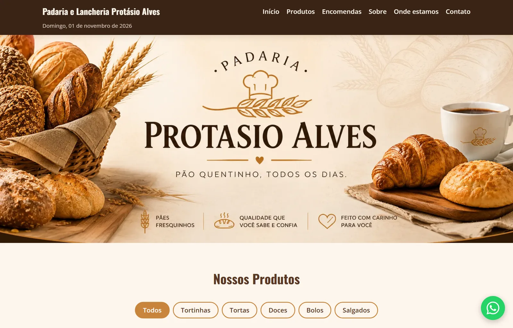

# Padaria e Lancheria Protásio Alves

Site da **Padaria e Lancheria Protásio Alves**, em Porto Alegre (RS), feito com React e Vite.

🔗 **Veja funcionando:** https://projeto-padaria-gilt.vercel.app/



## Funcionalidades

### Catálogo
- **30 produtos** com foto, preço (ou "Consulte") e filtro por categoria: tortinhas, tortas, doces, bolos e salgados
- **"Ver mais"**: mostra 8 produtos por vez, para a lista não ficar enorme no celular
- **"Perguntar no WhatsApp" em cada produto**: o cliente pergunta se o produto tem hoje, já que tudo é feito no dia e a disponibilidade muda

### Horários
- **"Aberto agora / Fechado agora"** que se atualiza sozinho a cada minuto (`useEffect` + `setInterval`)
- **Próximo horário**: "Fecha às 19:30", "Abre amanhã às 06:30", "Abre segunda às 06:30" ou, em recessos longos, "Abre dia 04/01 às 06:30"
- **Feriados e recessos**: nessas datas o site mostra a padaria como fechada e pula esses dias no "próximo horário"
- **Lista de horários** da semana com o dia de hoje em destaque

### Encomendas
- **Formulário de encomendas** (bolos de aniversário, pães em quantidade) que monta o pedido e envia pelo WhatsApp
- **Antecedência mínima** de 2 dias
- **Bloqueia dias fechados**: não deixa encomendar para domingo ou feriado

### Avisos
- **Faixa de avisos** no topo (feriados, horários especiais) que aparece e some sozinha conforme as datas cadastradas

### Geral
- **Mapa do Google** e botão "Como chegar", sem precisar de chave de API
- **Botão flutuante do WhatsApp** com mensagem pronta
- **Menu hambúrguer** no celular
- **Prévia do link** ao compartilhar no WhatsApp e redes sociais (Open Graph) e ícone próprio na aba (favicon)
- **Imagens otimizadas** em `.webp` (de 2–3 MB para menos de 200 KB cada)
- Layout **responsivo** e cuidados de **acessibilidade** (`alt` nas imagens, `aria-label` nos botões, título escondido para leitores de tela)

## Tecnologias

- [React 19](https://react.dev/)
- [Vite](https://vite.dev/)
- [dayjs](https://day.js.org/) para datas
- [sharp](https://sharp.pixelplumbing.com/) para converter as imagens
- [Vitest](https://vitest.dev/) para os testes automáticos
- CSS puro
- Deploy na [Vercel](https://vercel.com/)

## Como rodar no seu computador

Precisa ter o [Node.js](https://nodejs.org/) instalado.

```bash
npm install
npm run dev
```

Depois abra o endereço que aparecer no terminal (normalmente http://localhost:5173).

## Testes

As funções de lógica (horários, feriados, preço e link do WhatsApp) têm **27 testes automáticos** com [Vitest](https://vitest.dev/), cobrindo casos como "abre exatamente às 06:30", "sábado fecha ao meio-dia", "pula o domingo e o feriado" e "recesso de fim de ano".

```bash
npm test
```

Os testes ficam ao lado de cada arquivo, em `src/utils/*.test.js`.

## Organização do código

```
public/img/            fotos dos produtos (.webp)
scripts/               script que converte as fotos para .webp
src/
  App.jsx              junta os componentes na ordem da página
  index.css            estilos do site
  components/          um componente para cada parte da página
  data/
    padaria.js         telefone, endereço, horários, feriados, avisos e redes sociais
    produtos.js        lista de produtos e categorias
  utils/
    horario.js         aberto/fechado, próximo horário e feriados
    whatsapp.js        monta o link do WhatsApp com a mensagem
    preco.js           formata o preço em R$
```

Os dados da padaria ficam todos em `src/data/`. Para mudar um horário, cadastrar um feriado ou um aviso, mudar um preço ou adicionar um produto, basta editar esses arquivos. O site inteiro se atualiza a partir deles.

## Autor

Feito por **Tiago Pedrotti** · [GitHub](https://github.com/tPedrotti2003)
